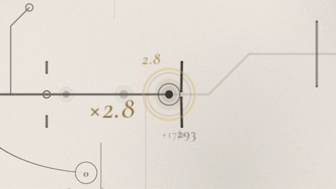
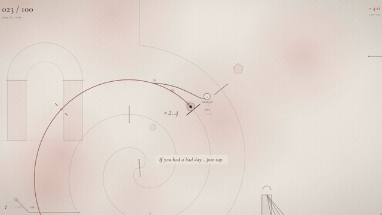
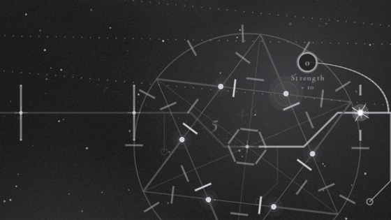
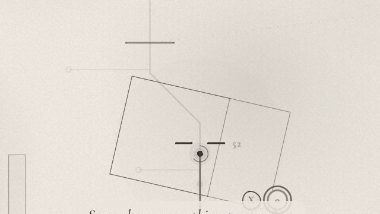
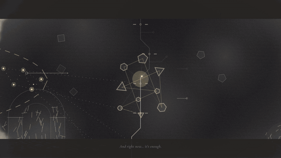

This is the biggest update since the demo came out. A player told me their forearm was sore from clicking, and that stuck with me. So I rebuilt the heart of the game around one idea: **you don't have to tap more, you can tap with the music.**

## Tap with the music

- **Taps on the beat are worth more**: ×2 at first, growing with every beat in a row, up to ×5. Damage, light, crits, everything.
- **Notes of light** climb the line and reach the tip on each beat, so you can see when to tap instead of guessing.
- The voice teaches it at the start, with a soft harp marking the beat until you find it.
- **Hold to keep going** when your hand gets tired: the tip keeps tapping on every half beat.
- Long runs are celebrated: at 4, 8, 12, 16… beats in a row, a little cascade of notes rises and lands in a chord, and gold rings bloom from the tip.

## A soundtrack of its own

Every part of the demo now has **its own song**: a gentle morning, a folk song with roots, a waltz in 3/4, a starry night, and a theme for the dark that slowly turns to major as you come out of it. The story and the letter at the end have theirs too.

- The beat you tap follows each song's own tempo and metre: the waltz really is one-two-three.
- **Your taps play along**, in the song's key, bar by bar, each song with its own colour: piano and harp in one, harp and celesta in the waltz, bells under the stars.

## A tiny orchestra

When your light splits into many and runs a star, **each light is an instrument**. Off the beat, one answers at a time. On the beat, they play together across the beat like a broken chord, more of them the longer your run, and each one glows as it sings.

## Gamepad support

- A (or either trigger) taps; hold it to keep going.
- RB / LB pick an upgrade on the tree, X buys it.
- Button prompts appear only when you play with a gamepad, drawn in the game's own ink, and they press themselves on the beat. PlayStation and Switch buttons are drawn as theirs.

## And also

- New voice lines for the lesson on the beat.
- The title screen now suggests headphones: the game is much better with them.
- Menus show clearly which option you're on.
- Fixed: texts misaligned when the view turns, and the voice talking over the story's question.

## Someone played it

Scansylabs recorded a playthrough on a rough day and called it *"My soul feels warmer."* Somewhere along the way they said it feels like a father talking to his child, which is exactly what the voice is meant to be. [Watch it on YouTube](https://www.youtube.com/watch?v=t2GSkboJzrA). Thank you for playing, and for sharing it.

Thank you to everyone who played and wrote to me. Comments like *"relaxing, I love this game"* and *"very peaceful"* are exactly what I hoped this game would feel like. I'd love to hear how the rhythm feels, especially whether the beat is easy to catch.

*AI disclosure: the narrator's voice and the soundtrack were generated with ElevenLabs from my own scripts and direction, and I use an AI assistant for programming. The design, the story, the art direction and the memories in it are mine.*
