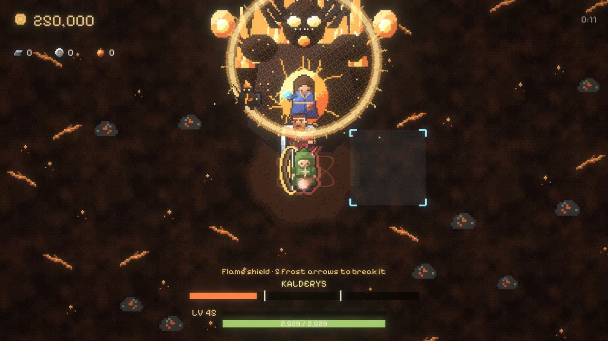
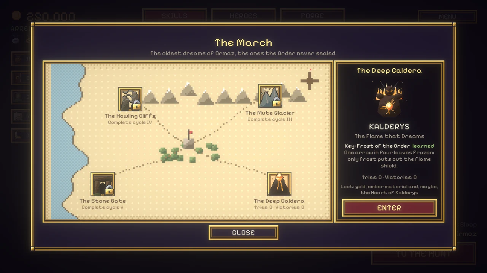
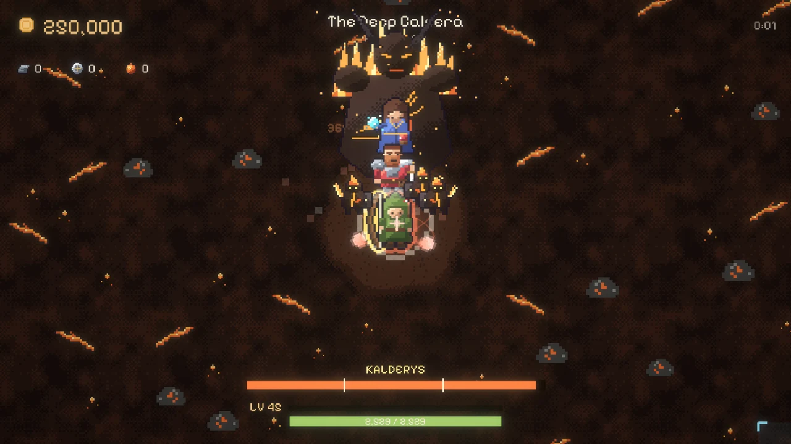
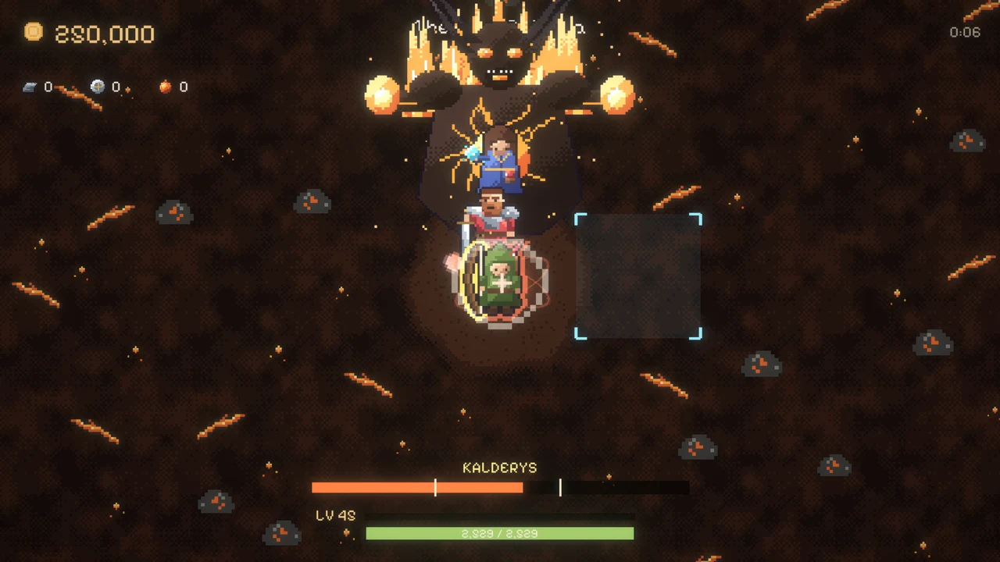
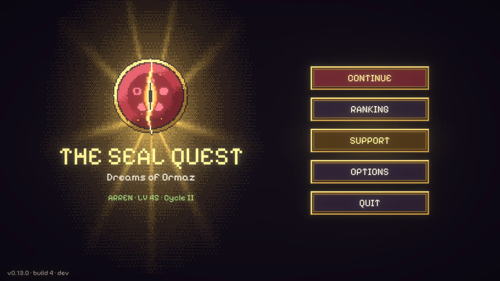
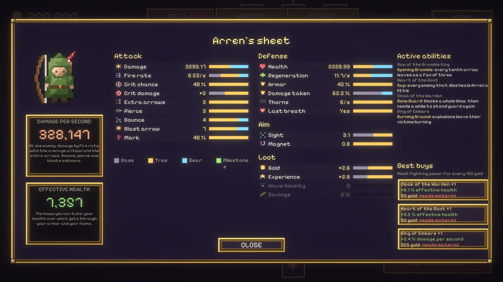
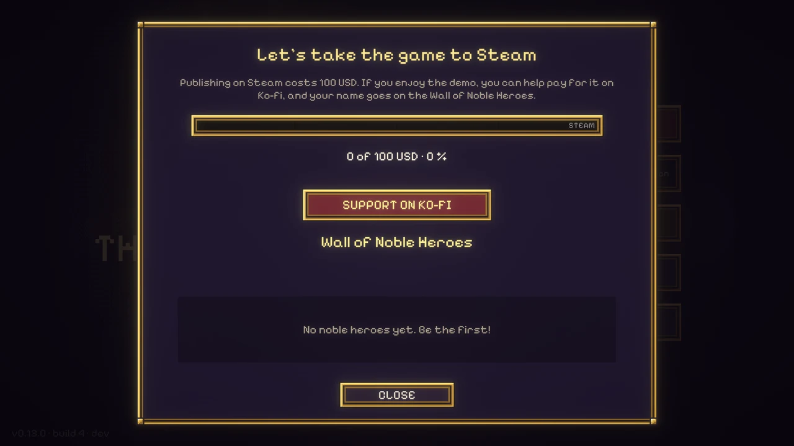

Cuando salió la demo, el final del Señor de las Brasas era el final del juego. Noventa y dos de ustedes llegaron y siguieron jugando sin nada más que perseguir. Esta actualización trata de lo que viene después: un ciclo más difícil para soñar de nuevo, un jefe de raid que cambia de forma, un ranking para escalar y una meta que podemos alcanzar entre todos.

## Soñar de nuevo

Vence al Señor de las Brasas y se abre el **Sueño inquieto**: el segundo ciclo. Vuelves a la Pradera con todo lo que compraste (el árbol, el oro, el nivel de Arren, la compañía, los ítems y la forja) y los épicos vuelven mucho más fuertes.

La primera vez que cae cada épico en el ciclo nuevo vuelve a pagar su cofre, y su ítem **despierta**: bonos más fuertes, dibujo nuevo y una habilidad única, desde un abanico de flechas de zarza hasta una guardia de huesos que aguanta un golpe entero. Cada ciclo que terminas deja una medalla, y un aura de luz crece alrededor de Arren.

Hay una regla importante: **soñar de nuevo se gana.** Solo puedes hacerlo cuando cae el último épico del ciclo en el que estás. A mitad de un ciclo el botón se ve apagado y te dice qué falta.

## Los raids elementales

Son los épicos especiales. Termina un ciclo y Arren aprende una **llave**, y se abre un lugar en el mapa de la Marca: fuego, hielo, viento y tierra, los sueños más viejos de Ormaz, los que la Orden nunca selló.

Un raid es una pelea aparte. Sin oleadas ni reloj: la compañía, un jefe de raid y cuatro guardias que vuelven cada vez que caen, un poco más rápido cada vez. El jefe tiene **tres fases**, y entre una y otra **muta**: destella, se sacude, crece y vuelve más furioso.

El primero es **Kalderys, la Llama que Sueña**, en la Caldera Profunda, abierto después del segundo ciclo.

En la segunda fase lanza brasas lentas hacia Arren que pegan fuerte al llegar, y tus flechas pueden derribarlas. En la tercera llueven brasas y un **escudo de llamas** se traga todos los golpes. Solo la llave lo rompe: *Frío de la Orden* hace que una de cada cuatro flechas salga helada, y cinco flechas heladas apagan el escudo por unos segundos.

Cada victoria paga oro y material de brasa. La primera vez, además, puede caer el **Corazón de Kalderys**, una joya con +20 % de daño y flechas que queman, en una ranura nueva que nada más puede ocupar. Cae segura antes de la octava victoria, así que la mala suerte nunca dura.

## Ranking de héroes

La primera vez que abres el juego puedes elegir un nick (o jugar anónimo) y entrar al ranking público. Primero cuentan las insignias, después la oleada más alta, después el nivel y después los enemigos que derrotaste. Cada partida, raid y ciclo actualiza tu fila. Puedes ver a los mejores héroes desde el menú principal y en la [página del juego](https://floppykey.com/seal-quest/#ranking).

## Un menú principal de verdad, y la ficha de Arren

El juego ahora abre en un menú principal con Continuar, Ranking, Apoyar, Opciones y Salir. Entre cacerías, el campamento está más ordenado: las pestañas al centro y una columna de accesos a la izquierda.

**STATS** abre la ficha de Arren: todos sus números, una barra que muestra cuánto pone la base, el árbol, el equipo y los hitos, su daño por segundo y su vida efectiva, sus habilidades activas y las tres compras que más poder de pelea dan por tu oro.

## Ayuda a que la cacería llegue a Steam

Publicar en Steam cuesta **100 USD**. Si la demo te sacó una sonrisa, puedes ayudar a pagarlo en [Ko-fi](https://ko-fi.com/floppykey). Cada café acerca un poco el juego completo, y tu nombre queda en el **Muro de los Héroes Nobles**, en el juego y en el sitio. Los tres que más aportan se destacan con un aura: naranja, amarilla y gris.

Apoyar no desbloquea nada en el juego: la demo es gratis e igual para todos.

## Lo que viene

Lo que ya está decidido:

- **Los otros tres raids**: el Glaciar Mudo, los Acantilados del Aullido y la Puerta de Piedra, cada uno con su jefe, su llave, su ataque y su defensa. Cada uno se abre con el ciclo que enseña su llave: el tercero, el cuarto y el quinto.
- **Más ciclos** después del Sueño inquieto, cada uno más difícil, con su medalla y su color en el aura de Arren.
- **Joyas que crecen**, y escenas y música propias para cada raid.
- Y el juego completo: **muchos más épicos**, **seis héroes** (Sor Edda, el Hermano Tobías y Nix se suman a la compañía), **elige a tu héroe**, un **árbol de habilidades más grande**, **mazmorras** y el final de la cacería. En Steam.

## Cuéntame qué te parece

1. ¿Soñaste de nuevo? ¿Hasta dónde llegaste en el Sueño inquieto?
2. Si enfrentaste a Kalderys: ¿el escudo y las flechas heladas se entendieron la primera vez?
3. ¿Preferirías jugar los otros tres raids antes del juego completo, o tener más épicos primero?

[Jugar la demo en itch.io](https://floppykey.itch.io/the-seal-quest-dreams-of-ormaz) · [Apoyar en Ko-fi](https://ko-fi.com/floppykey) · [La página del juego](https://floppykey.com/seal-quest/)
