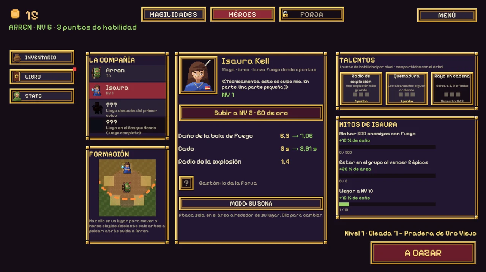

When the demo came out, the end of the Ember Lord was the end of the game. Ninety-two of you reached it and kept playing with nothing left to chase. This update is about what comes after: a harder cycle to dream through, a raid boss that changes shape, a ranking to climb and a goal we can reach together.

## Dream again

Beat the Ember Lord and the **Restless Sleep** opens: the second cycle. You go back to the Meadow with everything you bought (the tree, the gold, Arren's level, the company, the items and the forge) and the epics come back far stronger.

The first time each epic falls in the new cycle it pays its chest again, and its item **awakens**: stronger bonuses, new art, and a unique ability, from a fan of bramble arrows to a bone guard that takes a whole blow. Every cycle you finish leaves a medal, and an aura of light grows around Arren.

One rule matters: **dreaming again is earned.** You can only do it once the last epic of the cycle you are in has fallen. Halfway through a cycle the button stays dim and tells you what is missing.

## The elemental raids

These are the special epics. Finish a cycle and Arren learns a **key**, and a place opens on the map of the March: fire, ice, wind and earth, the oldest dreams of Ormaz, the ones the Order never sealed.

A raid is a fight of its own. No waves and no clock: the company, a raid boss, and four guards that come back every time they fall, a little faster each time. The boss has **three phases**, and between them it **mutates**: it flashes, shakes, grows and comes back angrier.

The first one is **Kalderys, the Flame that Dreams**, in the Deep Caldera, open after the second cycle.

In the second phase he throws slow embers at Arren that hit hard when they land, and your arrows can shoot them down. In the third, embers rain and a **flame shield** swallows every hit. Only the key breaks it: *Frost of the Order* makes one arrow in four leave frozen, and five frozen arrows put the shield out for a few seconds.

Every victory pays gold and ember material. The first time, it may also drop the **Heart of Kalderys**, a jewel with +20 % damage and arrows that burn, in a new slot nothing else can fill. It's certain within eight victories, so bad luck never lasts.

## Your company, your call

Each companion now has an **attack mode**, switched on their card in the Heroes tab:

- **Assist me:** they hit whatever you're aiming at, so the whole company focuses fire.
- **Their zone:** they fight on their own in the area around their spot, and the formation shows each guarded area. Put Brannoc in front to meet the crowd early, or behind to guard Arren.

Isaura starts out assisting and Brannoc guarding his zone, the way they fought before.

## Waves you can read

The lands got more personality, and your aim got more information:

- **Hot sides:** enemies still come from everywhere, but each land pushes hardest from two to four directions of its own (north and east in the Meadow).
- **Learnable waves:** every run of a land brings the same enemies in the same order, so your build and your aim decide the result, not luck. Where exactly they enter still changes.
- **Epics give you time:** each one always comes through the same entrance, from farther away, with an arrow on the edge of the screen showing where it's coming from.

## Rebalanced from your runs

The demo sends anonymous play stats, and they showed where people got stuck and where they walked straight through. So the numbers changed:

- **Swarms come in groups of 4** instead of 6, so wave 7 no longer doubles the crowd out of nowhere.
- **The Meadow is gentler:** its enemies have 15 % less health and the Bramble King 13 % less.
- **The later lands make you earn the path:** the Deep Wood, the Field of the Thousand and the Caldera ask for a few runs before their epic instead of letting you walk straight to it, and their epics were tuned to share the wall.
- **The campaign is a little longer:** the skill tree costs 13 % more, and enemies gain a bit more health per wave, with a bit more gold.
- **The second cycle has its own curve.** Whoever finishes the first cycle has the power of wave 40, so simply multiplying the numbers made it a stroll or a wall. The Restless Sleep grows flatter from a much higher start, and it was tuned so every epic takes a few tries again.

## Heroes' ranking

The first time you open the game you can pick a nick (or stay anonymous) and enter the public ranking. Insignias first, then the highest wave, then level, then the enemies you've beaten. Every run, raid and cycle updates your row. You can see the top heroes from the main menu and on the [game's page](https://floppykey.com/seal-quest/#ranking).

## A proper title screen, and Arren's sheet

The game now opens on a title screen with Continue, Ranking, Support, Options and Quit. Between hunts, the camp is tidier: the tabs in the middle, and a column of shortcuts on the left.

**STATS** opens Arren's sheet: every number he has, a bar that shows how much comes from the base, the tree, the gear and the milestones, his damage per second and effective health, his active abilities, and the three buys that give the most fighting power for your gold.

## Help the hunt reach Steam

Publishing on Steam costs **100 USD**. If the demo made you smile, you can help pay for it on [Ko-fi](https://ko-fi.com/floppykey). Every coffee brings the full game a little closer, and your name goes on the **Wall of Noble Heroes**, in the game and on the website. The three who give the most stand out with an aura: orange, yellow and grey.

Supporting doesn't unlock anything in the game: the demo is free and the same for everyone.

## What's coming

What's decided so far:

- **The other three raids**: the Mute Glacier, the Howling Cliffs and the Stone Gate, each with its own boss, its key, its attack and its defense. Each one opens with the cycle that teaches its key: the third, the fourth and the fifth.
- **More cycles** after the Restless Sleep, each harder, with its own medal and its own color in Arren's aura.
- **Jewels that grow**, and scenes and music of their own for every raid.
- And the full game: **many more epics**, **six heroes** (Sister Edda, Brother Tobías and Nix join the company), **choose your main**, a **bigger skill tree**, **dungeons**, and the way the hunt ends. On Steam.

## Tell me what you think

1. Did you dream again? How far did you get in the Restless Sleep?
2. If you faced Kalderys: did the shield and the frozen arrows make sense the first time?
3. Would you play the other three raids before the full game, or would you rather have more epics first?

[Play the demo on itch.io](https://floppykey.itch.io/the-seal-quest-dreams-of-ormaz) · [Support on Ko-fi](https://ko-fi.com/floppykey) · [The game's page](https://floppykey.com/seal-quest/)
