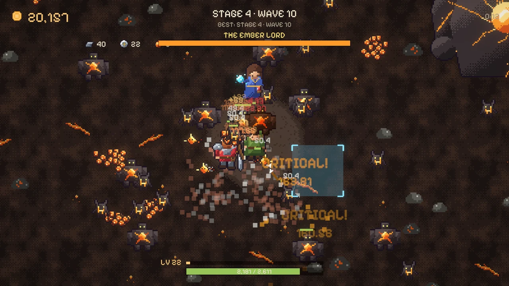
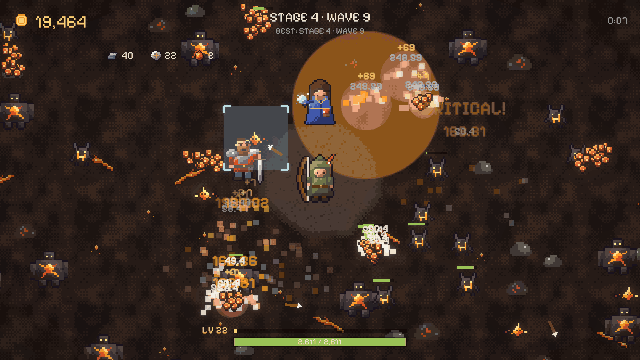
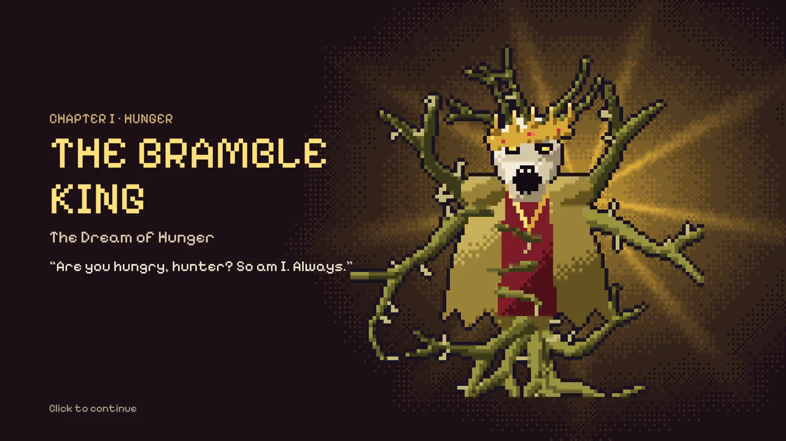
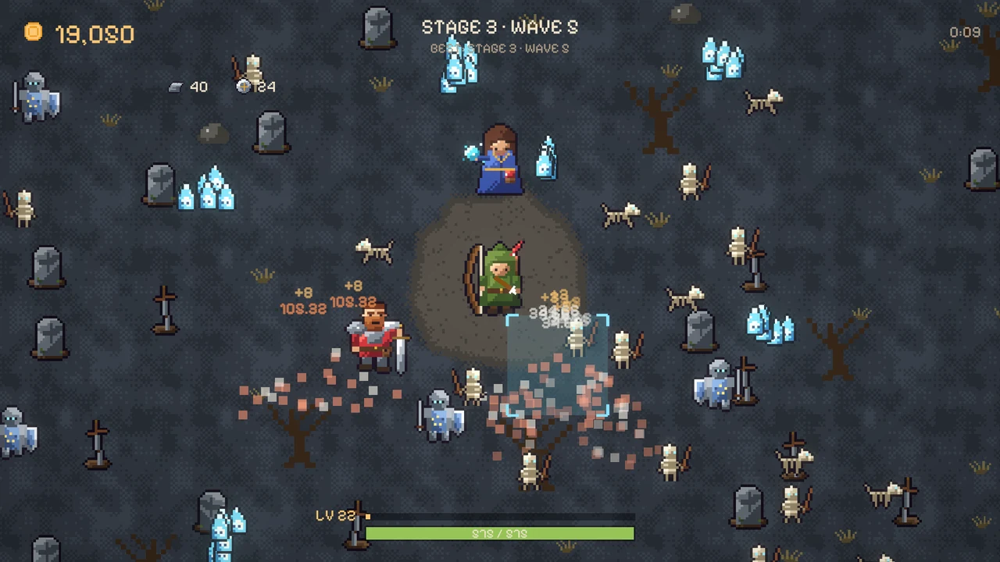
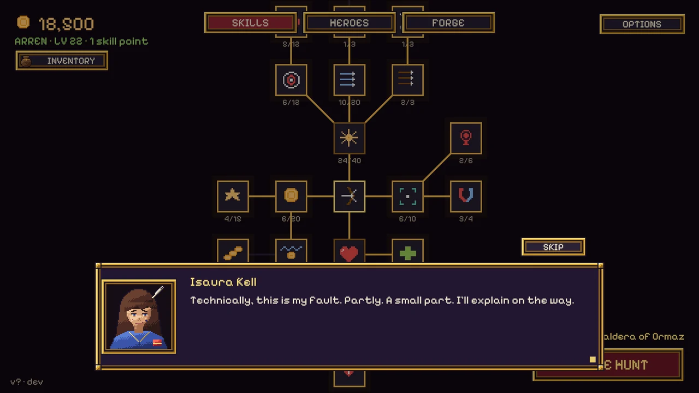
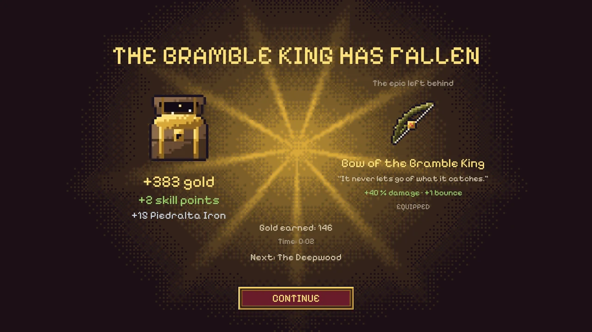
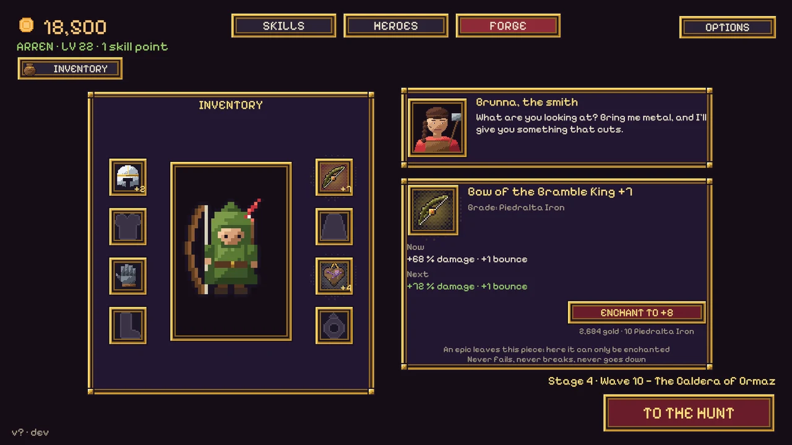

STRIKE! taught me what I like making: short games where every run pays for something, the screen fills up and you always want one more go. The second disk keeps all of that and adds what STRIKE! didn't have: a world, a company of heroes, and bosses worth hunting.

It's called **The Seal Quest: Dreams of Ormaz**.

## Aim. Upgrade. Hunt.

You hold a clearing in the middle of the screen and the waves come from every side. You only aim: no clicking, Arren shoots whatever is under the reticle. At first the waves walk right over you. That's the deal. Every run you die a little further, every run pays for something on the skill tree, and every run starts back at the wall, stronger.

## The epics

At the end of every land waits an **epic**: a huge beast with its own presentation, its own fight and a unique piece of loot you can only get from it. The common waves don't stop while you fight it.

The demo has four: the Bramble King, Rotroot, the Bone Warden and the Ember Lord. The full game goes much further.

## A world asleep on a dragon

The March of Vael rests on Ormaz, a dragon who fell asleep before the world began. A thousand years ago her nightmares crawled out of the ground as beasts, and the Order of the Fifth Seal locked them away for a thousand years. The thousand years are up. The seals are breaking.

You play Arren, a village archer, and the company grows along the way: Isaura Kell, a mage who throws fire where you aim and knows more than she says; Brannoc Half-Gold, a mercenary who runs out, cuts and comes back; and Brunna, the smith of Piedralta. The story is told between runs, in short scenes.

## Loot that feels earned

The first time an epic falls it drops a chest and a piece nobody else in the March has. Then you take it to Brunna, who crafts helmets, breastplates, gauntlets and boots from the metal the epics drop, and enchants anything from +1 to +10. It never fails, never breaks, never goes down. At +4 it starts to glow.

## What's next

A free demo with the first four epics is coming to itch.io, in the browser and on Windows, in English and Spanish. It's about half an hour of play. Like STRIKE!, every number in it will be tuned with what players do, so it's going to change.

There's a page with more about the game: [floppykey.com/seal-quest](https://floppykey.com/seal-quest/).
