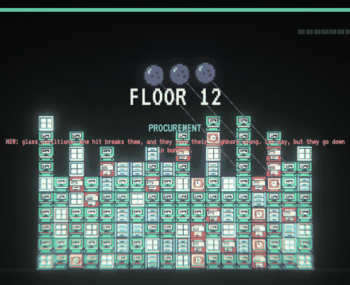
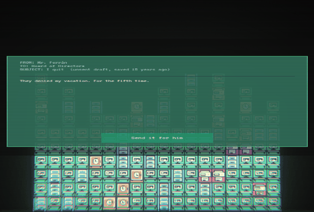
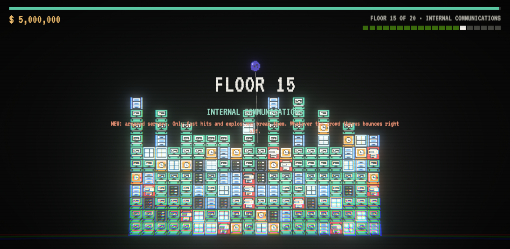
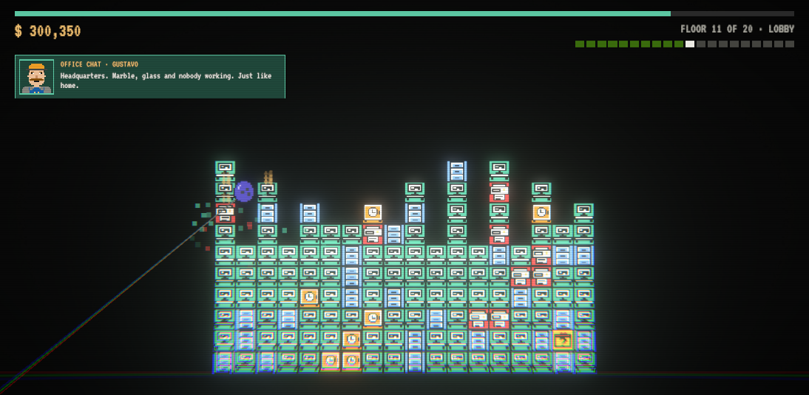
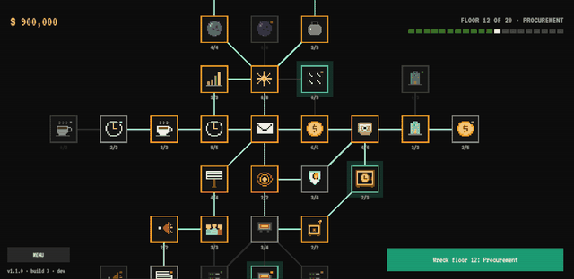
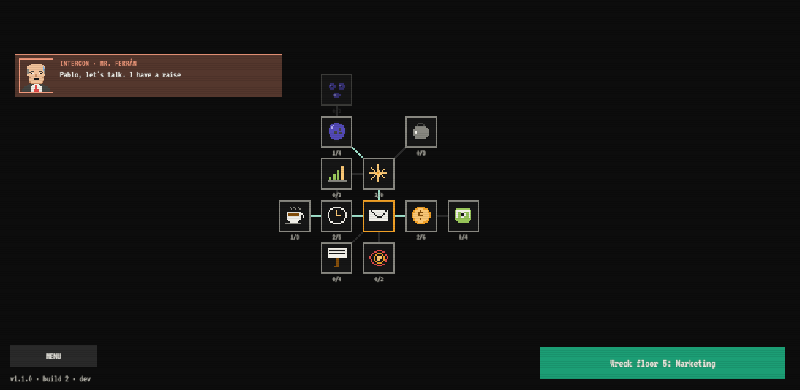
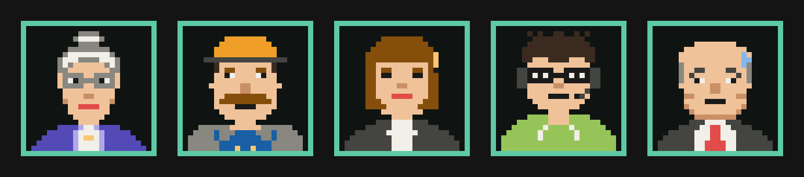

Thanks to everyone who played the first public build! Almost everyone who started made it to the boss's office, and some of you started over right away. The most common message was "I want more". So here's more: a whole second act, with ten new floors, new blocks, new upgrades and a new final boss.

## The story continues

You sent Mr. Ferrán's resignation for him. A minute later, the reply arrives: **Chairman Augusto**, head of the whole Group, denies both resignations and your vacation, for the sixth time. "If you have anything else to say, I'm on the 20th floor of headquarters. Nobody has ever made it up here."

So you're going to headquarters. Ten new floors, from the **Lobby** to **The Chairman's Office**, through Procurement, Audit, Training, Corporate Finance, the Innovation Lab, Compliance and The Board. Each floor has its own grievance, memos and office chat, plus handwritten notes in the margins about who Augusto really is.

Already beat the game? **Your save picks up right where act 2 begins**, with your money and upgrades.

## New blocks

- **Glass partitions:** one hit breaks them, and they take their neighbors along. Low pay, but they go down in bunches.
- **Armored servers:** only fast hits and explosions break them. Whatever the crowd throws bounces right off, so swing hard.

## Surprise boxes

From floor 3 on, some runs hide a **lost-and-found box** at the bottom of the building, walled in by filing cabinets (or servers, at headquarters). Dig your way to it and you get one of three prizes:

- **Cash:** 10% of the floor bonus.
- **Overtime:** +3 seconds on the clock.
- **Double espresso:** your ball hits 50% harder for 4 seconds.

They're small on purpose. They're a reason to aim somewhere hard, not a shortcut.

## Twelve new upgrades

The org chart grows from 19 to 31 nodes, each branch reaching further out:

- **Wrecking Ball** and **Critical Hit** (sometimes double damage) from Gustavo.
- **Double Shift** and **Auto Clock-In** from Ms. Elsa.
- **Compound Interest** (all your money is worth more) and **Year-End Bonus** from Marta.
- **Chain Reaction** and **Short Circuit** (servers explode) from Kevin.
- **National March** and **General Walkout** from the crowd outside.
- Two new combos: **Tempered Glass** and **Hack**.

## A bigger org chart you can move around

Nodes now have room to breathe, in the style of Nodebuster. **Drag with the mouse** to move around and **use the wheel to zoom in and out**.

## Faces in the office chat

Your coworkers (and the boss) now have pixel portraits next to their messages in the office chat.

## Fixes

- Your money and floor progress were hidden behind some screens.

## Feedback welcome

Act 2 is fresh, and its balance is my first pass. If a floor feels like a wall, or way too easy, please tell me which one in the comments. That's exactly what I need for the next update.

The game sends basic play stats (floor reached, runs, minutes and the name you typed) so I can see where people get stuck. You can turn them off in the menu.

Thanks for playing!
— Pablo, Floppy Key
