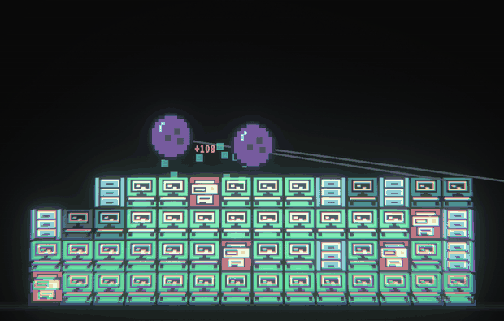
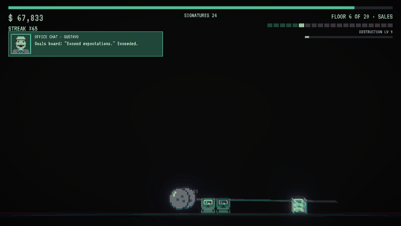
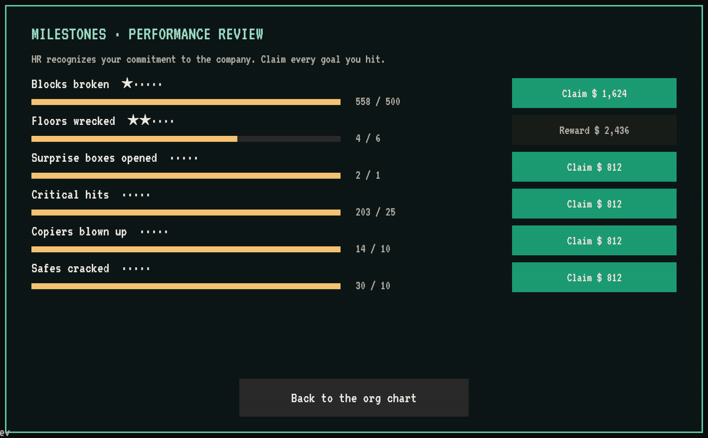
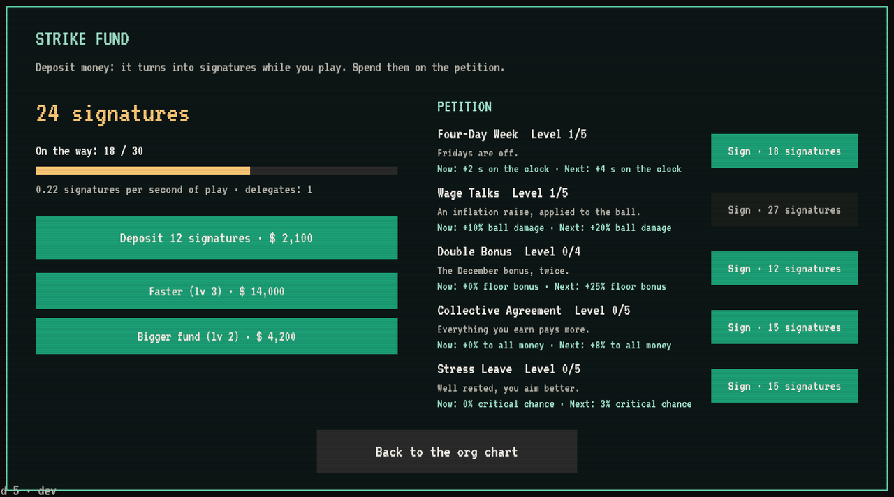
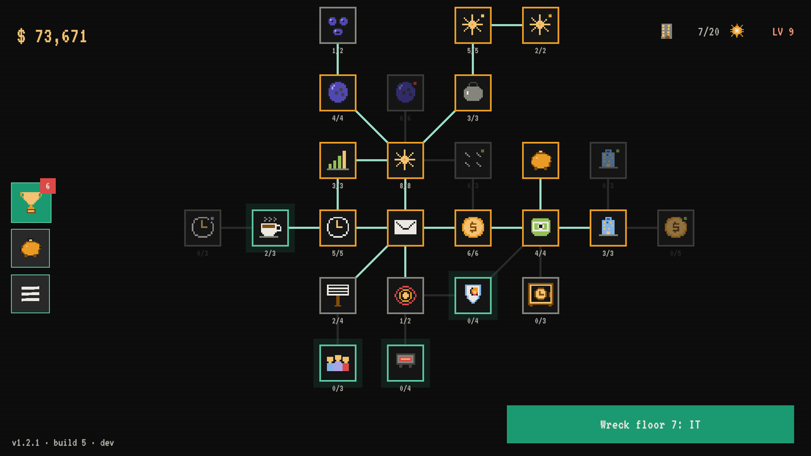

The play stats from v1.2.1 told me two things. Once you had the hang of the org chart, runs started to feel samey: there was nothing else to chase between floors. And floor 7 (IT) was a wall: lots of runs ending a few blocks short. This update adds new things to work toward, makes hits feel bigger and smooths out the curve.

## Critical hits, from act 1

**Critical Hit** now unlocks on floor 4 instead of the headquarters, and it has a follow-up: **Precision Strike** pushes criticals from ×2 to ×3 and then ×4. Every critical slams a big sign onto the screen with the multiplier and the damage, from yellow to orange to red.

## Wrecking a floor feels like it

When the last block falls, the screen shatters into pieces and a red rubber stamp hits the middle: **FLOOR 6 · DEMOLISHED**. The next memo is already waiting underneath.

## Milestones

From floor 3, the org chart has a **trophy** button: HR's performance review. Blocks broken, floors wrecked, surprise boxes, critical hits, copiers blown up, safes cracked, and two more for headquarters. Each one has several steps, and each step pays a cash bonus tied to your current floor. A red dot tells you when there's something to claim, and a notice pops up during the run when you hit one.

## The Strike Fund

This is the big one. Buy the **piggy bank** node (right above Severance, from floor 5) and a new screen opens:

- **Deposit money** into the fund. While you play, it turns into **signatures**, but only during runs, so it pays to keep breaking things.
- Spend signatures on **the Petition**: Four-Day Week (longer runs), Wage Talks (+ball damage), Double Bonus (+floor bonus), Collective Agreement (+all money) and Stress Leave (+crits).
- Upgrade the fund's **speed** and **size** with money. Every coin you put there is a coin you don't spend on the org chart. Your call.
- Surprise boxes can now give you a **union delegate**, who speeds up the fund.

## Destruction level

A bar under the floor counter fills as you break blocks. Every level adds **2% to all the money you make**, forever. It's slow, it's steady, and it never stops going up.

## A cleaner org chart

Milestones, the Strike Fund and the menu are now icons on the left edge. Between runs, the floor and level shrink to the top-right corner so the org chart gets the whole screen.

## Balance

- Floor 7 is no longer a wall, and floors 7 and 8 ramp up more gently. The rest of act 1 is slightly tougher, so it doesn't fly by.
- Upgrades cost more, especially at headquarters, to make room for everything the fund, milestones and levels give you.
- The late headquarters floors (16, 17 and 18) are a bit softer. Several of you quit floor 17 with 95% of it destroyed. I'm sorry!

## One small ask

I'm making this game on my own. If you're enjoying it, a **rating on itch.io** helps more than you'd think. There's a button for it at the end of the game.

The game sends basic play stats (floor reached, runs, minutes and the name you typed) so I can see where people get stuck. You can turn them off in the menu.

Thanks for playing!
— Pablo, Floppy Key
